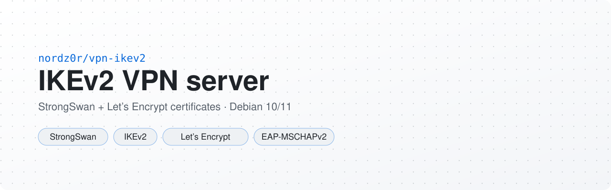
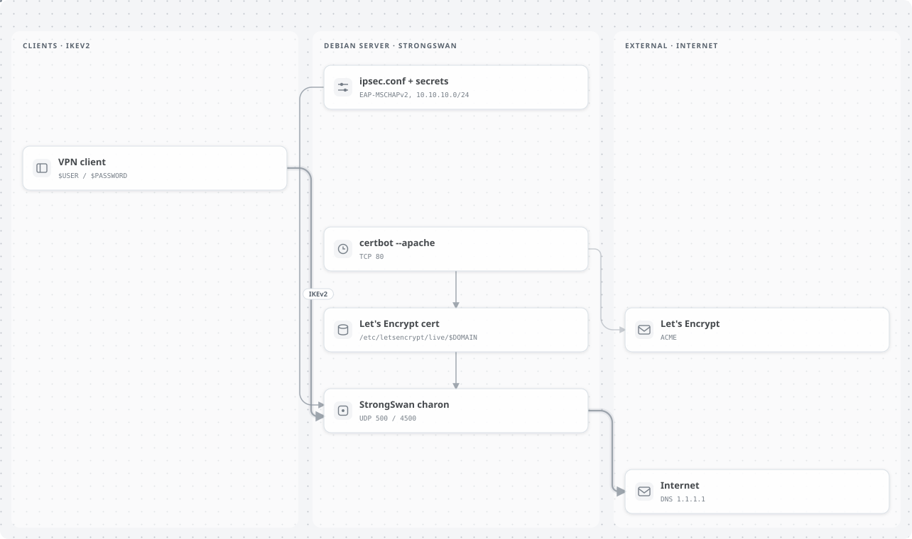

<p align="center">
  <picture>
    <source media="(prefers-color-scheme: dark)" srcset=".github/assets/banner-dark.svg">
    <source media="(prefers-color-scheme: light)" srcset=".github/assets/banner-light.svg">
    
  </picture>
</p>

<p align="center"><a href="README.md">Русский</a> · <b>English</b></p>

<p align="center">
  
  
  
  <a href="LICENSE"></a>
</p>

Manual setup of an IKEv2 VPN server on StrongSwan with a Let's Encrypt certificate and EAP-MSCHAPv2 (login/password) clients. Tested on Debian 10/11.

<p align="center">
  <picture>
    <source media="(prefers-color-scheme: dark)" srcset=".github/assets/architecture-dark.svg">
    <source media="(prefers-color-scheme: light)" srcset=".github/assets/architecture-light.svg">
    
  </picture>
</p>

## Requirements

- Open firewall ports: `UDP/500`, `UDP/4500` (StrongSwan), `TCP/80` (certbot)
- Your own domain, e.g. `vpn.domain.com`

## Installation

```
sudo apt update
sudo apt install -y strongswan strongswan-pki libcharon-extra-plugins python3-certbot-apache
```

Variables below: `$DOMAIN` — your domain, `$USER` — username, `$PASSWORD` — password.

Get a certificate for `$DOMAIN`:

```
certbot certonly --apache -d $DOMAIN --register-unsafely-without-email --agree-tos
```

### Configs

* /etc/ipsec.conf
```
config setup
    charondebug = "ike 1, knl 1, cfg 1, net 1"
    uniqueids = never

conn $DOMAIN
    auto = add
    compress = no
    type = tunnel
    keyexchange = ikev2
    fragmentation = yes
    forceencaps = yes
    dpdaction = clear
    dpddelay = 300s
    rekey = no
    left = %defaultroute
    leftid = @$DOMAIN
    leftcert = /etc/letsencrypt/live/$DOMAIN/fullchain.pem
    leftsendcert = always
    leftsubnet = 0.0.0.0/0
    right = %any
    rightid = %any
    rightauth = eap-mschapv2
    rightsourceip = 10.10.10.0/24
    rightdns = 1.1.1.1
    rightsendcert = never
    eap_identity = %identity
    ike = aes256-sha256-modp2048,aes128-sha1-modp1024,3des-sha1-modp1024!
    esp = aes256-sha256,aes128-sha1,3des-sha1!
    dpdaction = restart 
```

* /etc/ipsec.secrets
```
$DOMAIN : RSA "/etc/letsencrypt/live/$DOMAIN/privkey.pem"
$USER : EAP "$PASSWORD"
```

### Let StrongSwan read the certificates
```
sudo apt install -y apparmor-utils
sudo aa-complain /usr/lib/ipsec/charon
sudo aa-complain /usr/lib/ipsec/stroke
cat /etc/letsencrypt/live/$DOMAIN/chain.pem > /etc/ipsec.d/cacerts/ca.pem
```

## Usage

```
sudo ipsec restart
sudo update-rc.d ipsec defaults
```

Clients connect over IKEv2 to `$DOMAIN` with `$USER` / `$PASSWORD` and get an address from `10.10.10.0/24`, DNS `1.1.1.1`.

## TODO

- [ ] Script for automatic installation

## License

MIT, see [LICENSE](LICENSE).
